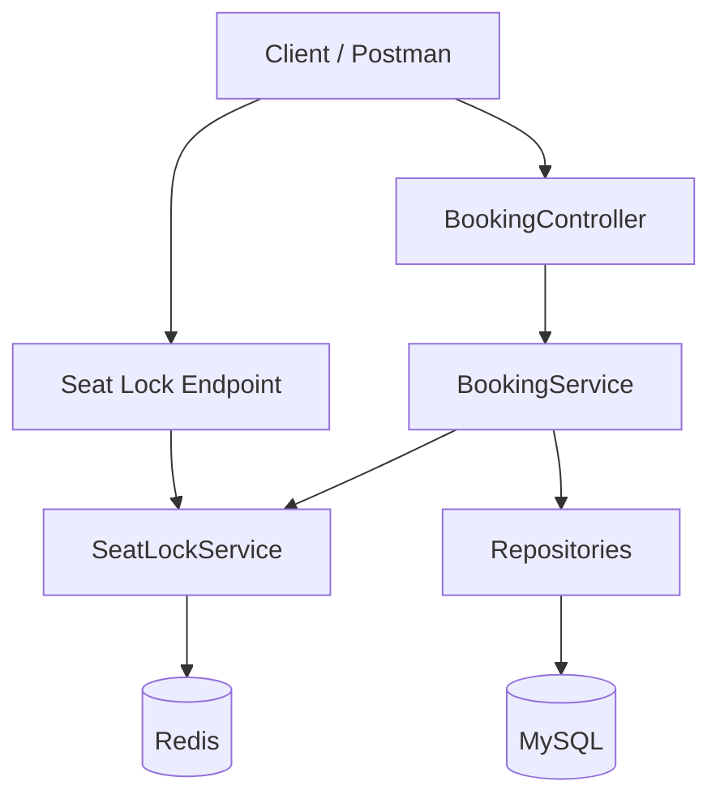

# Event-Driven Ticket Booking System

A backend ticket booking platform built with **Java, Spring Boot, MySQL, and Redis**, designed to explore concurrency control, temporary seat reservations, and reliable booking workflows.

> **Project status:** In development. The current focus is implementing the core booking workflow and Redis-based seat locking.

## 1. Overview

Ticket booking systems face a challenging problem: multiple users may attempt to reserve the same seat simultaneously.

A naive implementation that checks whether a seat is available and then updates its status can allow competing requests to pass the availability check before either request completes.

This project explores how to design a booking workflow that temporarily reserves seats, controls competing requests, verifies ownership, and persists confirmed bookings in a relational database.

The goal is to build a backend that demonstrates practical system design concepts rather than simply implementing CRUD operations.

## 2. Tech Stack

- **Language:** Java 21
- **Backend:** Spring Boot
- **Build tool:** Maven
- **Database:** MySQL
- **Caching and temporary locks:** Redis
- **API testing:** Postman
- **Containerization:** Docker, for running Redis locally

Kafka and a distributed deployment architecture are not part of the current implementation scope.

## 3. System Design Problems and Solutions

### Problem 1: Concurrent Seat Booking

**The problem**

Suppose two users attempt to book seat 5 for the same event at almost the same time.

A naive workflow might look like this:

1. User A checks whether the seat is available.
2. User B checks whether the seat is available.
3. Both requests observe that the seat is available.
4. Both attempt to create a booking.

This creates a race condition and can result in conflicting booking attempts.

**Our solution: Redis-based temporary seat locking**

Before confirming a booking, a user attempts to acquire a temporary lock on the requested seat.

We use a Redis key that identifies the event and seat, with the lock value identifying its owner.

Example:

`seat:event101:5`

The lock is acquired using Redis's atomic `SET` operation with `NX` and `EX` options:

```redis
SET seat:event101:5 user123 EX 300 NX
```

- `NX` — create the key only if it does not already exist.
- `EX 300` — expire the key after 300 seconds.
- `user123` — identifies the lock owner in this simplified example.

Only one competing request can successfully create the same lock key while that key exists.

**Design principle:** The lock acquisition operation is atomic. We don't rely on a separate availability check to decide which competing request wins the temporary reservation.

### Problem 2: Temporary Reservations That Never Expire

**The problem**

A user might acquire a seat lock and then abandon the booking process. Without expiration, that seat could remain unavailable indefinitely.

**Our solution: Redis TTL**

We assign a time-to-live (TTL) to each temporary lock.

For example, a five-minute lock allows a user to complete the booking within a limited reservation window. If the lock expires without a successful booking, the key is removed automatically and the seat can be claimed again, subject to the database's actual booking status.

Useful Redis commands:

```redis
TTL seat:event101:5
GET seat:event101:5
```

Redis TTL results:

- A positive number indicates the remaining lifetime in seconds.
- `-1` means the key exists without an expiration.
- `-2` means the key does not exist.

**Important distinction:** Lock expiration releases the temporary reservation; it does not itself update the MySQL seat status.

### Problem 3: Preventing Unauthorized Booking Confirmation

**The problem**

Acquiring a lock is not enough. A different user must not be able to confirm a booking using someone else's temporary reservation.

**Our solution: Lock ownership validation**

The booking workflow verifies that the requesting user owns the lock for the selected seat.

Conceptually:

1. The user requests a temporary seat lock.
2. Redis records the lock owner.
3. The user submits a booking request.
4. The booking service verifies lock ownership.
5. The service checks the seat's persisted booking status.
6. The booking proceeds only if the required validations succeed.

The lock is associated with a specific event and seat, so ownership validation must use the corresponding lock key and owner identity.

In a production implementation, ownership checks and lock release must also account for expiration and reacquisition. A stale owner must never be allowed to release a newer owner's lock.

### Problem 4: Keeping Redis and MySQL Responsibilities Separate

**The problem**

Redis is suitable for fast, temporary coordination, but a temporary lock should not become the permanent source of truth for a confirmed booking.

**Our solution: Separate responsibilities**

| Component | Responsibility |
|---|---|
| Redis | Temporary seat locks and expiration |
| MySQL | Users, events, seats, and confirmed bookings |
| Spring Boot services | Booking validation and business logic |
| Controllers | HTTP request handling |
| Repositories | Database persistence |

The `SeatService` manages persisted seat data, while the `SeatLockService` manages temporary seat reservations.

This separation helps distinguish an unconfirmed reservation from a completed booking.

### Problem 5: Maintaining Booking Consistency

**The problem**

A successful booking may involve multiple related database changes, such as creating a booking record, marking a seat as booked, and updating event availability.

If these changes are not coordinated, the database may end up in an inconsistent state.

**Our solution: Transactional booking workflow**

The planned booking workflow uses Spring's transaction management for related MySQL operations.

At a high level:

1. Validate the user, event, and seat.
2. Verify that the requester owns the temporary lock.
3. Check that the seat has not already been booked.
4. Create the booking record.
5. Update the seat's persistent status.
6. Update event availability where applicable.
7. Release the temporary lock after successful confirmation.

The database changes should succeed or roll back together when they participate in the same transaction.

**Important design consideration:** A MySQL transaction does not automatically make Redis operations transactional with MySQL. Production-grade implementation must handle failures between database commits and lock release, and must protect against concurrent booking attempts using appropriate database constraints or conditional updates.

### Problem 6: Handling High Contention for Popular Events

**The problem**

A popular event can receive a large number of simultaneous requests for a limited number of seats. Even a fast database cannot eliminate race conditions if competing requests are not coordinated correctly.

**Our solution: Atomic claims and layered validation**

The design uses multiple layers of protection:

- Redis atomic lock acquisition to select a temporary lock owner.
- TTL to prevent abandoned locks from persisting indefinitely.
- Ownership validation to reject requests that do not own the reservation.
- Database-side validation and transactional persistence to protect confirmed bookings.

The principle is that a temporary lock grants a reservation opportunity, not unconditional permission to create a booking.

The current project does not yet claim to have been load-tested at a specific traffic volume. High-throughput testing, failure recovery, and multi-instance deployment remain areas for future validation.

## 4. Architecture



### Component responsibilities

- **BookingController:** Receives booking requests and delegates business operations.
- **BookingService:** Coordinates validation and booking creation.
- **SeatLockService:** Acquires and checks temporary seat locks in Redis.
- **SeatService:** Manages persisted seat information.
- **Repositories:** Retrieve and persist application entities.
- **MySQL:** Stores durable application data.
- **Redis:** Stores temporary seat-lock keys with expiration.

## 5. Booking Workflow

The intended booking sequence is:

1. A user selects an event and seat.
2. The application attempts to acquire the seat's Redis lock.
3. Redis atomically grants the lock to one claimant.
4. The user submits a booking request.
5. The booking service retrieves the relevant user, event, and seat.
6. The service validates lock ownership and database availability.
7. The application persists the booking and related seat changes in a database transaction.
8. The temporary lock is released after successful confirmation.
9. If the user abandons the process, the TTL eventually removes the lock.

A failed booking must not be treated as a confirmed reservation. Lock release and recovery behavior must also be designed so that failures do not remove another user's lock or leave the database inconsistent.

## 6. Current Implementation

The project has been developed incrementally, with work including:

- Spring Boot and Maven project setup.
- MySQL database connectivity and JPA entity persistence.
- User, event, seat, and booking entities and repositories.
- Booking request DTOs.
- Booking controller and service structure.
- Redis connectivity and basic Redis operations.
- Temporary seat-locking concepts using TTL.
- Lock ownership validation in the booking workflow.
- Integration of booking creation with seat status updates.
- API testing using Postman.

The exact completion status of individual integration and failure-handling cases should be verified against the latest source code and tests.

## 7. Getting Started

### Prerequisites

Install or configure:

- Java 21
- Git
- MySQL 8.x
- Docker Desktop with WSL 2 support on Windows, if using Docker for Redis
- Postman, for API testing

### Clone the repository

```bash
git clone https://github.com/adicoolls/Event-Driven-Ticket-Booking-System.git
cd Event-Driven-Ticket-Booking-System
```

### Configure the database

Create the database in MySQL:

```sql
CREATE DATABASE ticket_booking;
```

Configure the database connection in `src/main/resources/application.properties`:

```properties
spring.datasource.url=jdbc:mysql://localhost:3306/ticket_booking
spring.datasource.username=${DB_USERNAME}
spring.datasource.password=${DB_PASSWORD}
```

Set your database credentials through environment variables. Do not commit real passwords or secrets to GitHub.

For PowerShell:

```powershell
$env:DB_USERNAME = "root"
$env:DB_PASSWORD = "YOUR_ACTUAL_PASSWORD"
```

Keep the application running in the same terminal session in which the variables are configured.

### Start Redis

If using Docker, run:

```powershell
docker run -d --name ticket-redis -p 6379:6379 redis:latest
```

If the container already exists but is stopped, start it instead:

```powershell
docker start ticket-redis
```

Verify Redis connectivity:

```powershell
docker exec -it ticket-redis redis-cli ping
```

Expected output:

```text
PONG
```

Ensure the Spring Boot Redis configuration points to the correct host and port, typically `localhost:6379` for this local setup.

### Run the Spring Boot application

On Windows PowerShell:

```powershell
.\mvnw.cmd spring-boot:run
```

On systems with a suitable Maven installation:

```bash
mvn spring-boot:run
```

Check the application logs for successful startup and database connectivity.

## 8. Security and Reliability Considerations

This project is a learning and development implementation. Before using a similar design in production, additional safeguards are required:

- Database constraints to prevent duplicate confirmed bookings for the same seat.
- Conditional database updates or appropriate locking for concurrent booking confirmation.
- Safe lock ownership checks and owner-verified release.
- Recovery strategies for failures between Redis and MySQL operations.
- Authentication and authorization for booking APIs.
- Input validation and meaningful API error responses.
- Automated integration and concurrency tests.
- Monitoring, timeouts, and load testing.

Redis locks improve coordination, but they do not replace durable database integrity constraints.

## 9. Future Improvements

Potential next steps include:

- Automated unit, integration, and concurrent booking tests.
- Improved handling of lock expiration and failed bookings.
- Stronger database-level concurrency protection.
- Idempotency for repeated booking requests.
- Centralized exception handling and API documentation.
- Load testing for popular events and high contention.
- Docker Compose for repeatable local development.
- Kafka for asynchronous events such as booking confirmations and notifications, if justified by the architecture.
- Observability and metrics for lock acquisition, booking failures, and system performance.

These are planned improvements, not claims about the current implementation.

## 10. Learning Outcomes

This project explores practical backend engineering concepts:

- Race conditions and concurrency control.
- Atomic Redis operations and TTL.
- Temporary reservations versus durable state.
- Spring Boot dependency injection and layered architecture.
- JPA and relational database persistence.
- Transactional consistency and failure recovery.
- Separation of responsibilities between Redis and MySQL.
- System design trade-offs under high contention.

## License

No license has been selected for this repository yet. Add a license if and when you decide how others may use, modify, and distribute the project.
